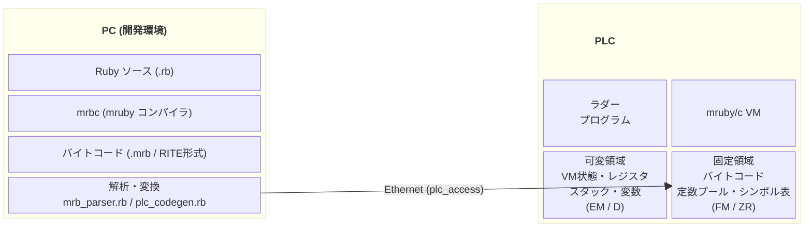
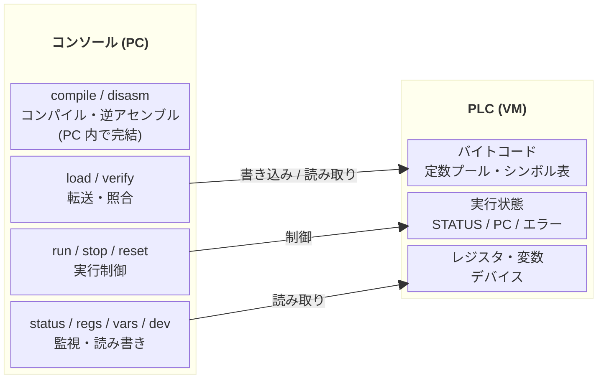

# システム構成ブロック図

## 説明

- **PC 側**: Ruby ソースを `mrbc` でバイトコードにコンパイルし、
  `mrb_parser.rb` / `plc_codegen.rb` で PLC のレジスタ値に変換する。
- **通信**: 変換したレジスタ値を Ethernet 経由で PLC のメモリに書き込む。
- **PLC 側**: ラダープログラムと mruby/c VM が併存する。
  PC からコンパイル済みのバイトコードを受け取り、VM が Ruby プログラムを実行する。
  - **可変領域**: 実行中に変わるデータ (VM 状態、レジスタ、スタック、変数)。キーエンスは EM、三菱は D
  - **固定領域**: 実行中に変わらないデータ (バイトコード、定数プール、シンボル表)。キーエンスは FM (ZF バンク)、三菱は ZR

## コンソール操作

- **compile / disasm**: PC 内で完結する。Ruby ソースをコンパイルし、バイトコードを確認する
- **load / verify**: コンパイル結果を PLC メモリに書き込む。verify は書き込み後の照合
- **run / stop / reset**: VM の実行状態を制御する
- **status / regs / vars / dev**: VM の状態やレジスタ、デバイスの値を読み取る
